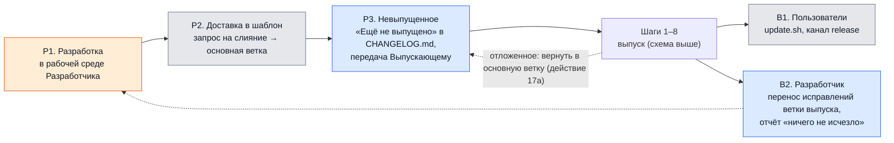

# Выпуск шаблона IWE — схема конвейера, этапы, роли, методы

## Схема

Цвет — кто исполняет: серый — программа, синий — ИИ-агент, оранжевый — человек; двойная рамка — решает человек. Пунктир — возвраты.

```mermaid
flowchart LR
    IN[/"Доработки Разработчика<br/>в основной ветке шаблона<br/>с полями «Цель · Результат»,<br/>«Как проверить», «Как откатить»"/]
    S1["1. Снимок<br/>ветка release/v&lt;N&gt;"]
    S2["2. Поля и коды<br/>каждая запись размечена"]
    S3[["3. Отбор состава<br/>Выпускающий"]]
    S4["4. Сборка-кандидат<br/>метка rc.K"]
    S5["5. Проверки на кандидате<br/>программы · рецензент · аудитор кода ·<br/>тестировщики · red team — параллельно"]
    S6["6. Сверка доказательств<br/>отметки того же дерева"]
    S7[["7. Согласование и выпуск<br/>Выпускающий, затем release.yml"]]
    S8["8. После выхода<br/>наблюдение, итог выпуска,<br/>пересборка табло"]
    IN --> S1 --> S2 --> S3 --> S4 --> S5 --> S6 --> S7 --> S8
    S5 -. "находка: исправление на ветке" .-> S4
    S6 -. "расхождение" .-> S4
    S3 -. "отложено" .-> IN
    S7 -. "принятая оговорка → в анонс" .-> S8
    classDef program fill:#e5e7eb,stroke:#6b7280,color:#111827
    classDef agent fill:#dbeafe,stroke:#2563eb,color:#111827
    classDef human fill:#ffedd5,stroke:#ea580c,color:#111827
    class S1,S4 program
    class S2,S6 agent
    class S3,S7,S8 human
    class S5 agent
```

| Шаг | Готово, когда | Этапы ниже | Где записано |
|---|---|---|---|
| 1. Снимок | ветка выпуска нарезана с вершины основной ветки | 1 | шаблон |
| 2. Поля и коды | у каждой записи раздела версии три поля и код результата | 2 | `CHANGELOG.md` ветки выпуска |
| 3. Отбор состава | каждая запись взята или отложена | 3 | `decisions.md` |
| 4. Сборка-кандидат | метка `v<N>-rc.<K>` поставлена, дерево записано | 4 | шаблон, запрос на слияние |
| 5. Проверки на кандидате | все строки протокола отмечены, вердикт red team получен — для одного дерева | 5–9, 10 | `tests/rc.<K>/`, `decisions.md` |
| 6. Сверка доказательств | отметки и вердикт относятся к выпускаемому дереву | 11 | комментарий в запросе |
| 7. Согласование и выпуск | решение Выпускающего записано в строку «Итог» формы решений, `release.yml` поставил `v<N>` | 12–13 | `decisions.md`, шаблон |
| 8. После выхода | опубликованное проверено, атака на вышедшую версию проведена, исправления ветки выпуска перенесены в рабочую среду Разработчика без потерь, табло пересобрано, английская поставка и рассылки сделаны; окно наблюдения прошло: «держим» или откат | 14 | `decisions.md`, `board/`, журнал выпусков шаблона |

Если вы тестировщик — вам шаг 5 и [инструкции тестировщикам](../team/tester/README.md); Выпускающий — шаги 3 и 7 и [инструкция](../team/release-lead/instruction.md); новичок — [как присоединиться](../team/join.md). Что каждый шаг берёт и отдаёт и какая программа его исполняет — [функционально-модульное описание](functional-modular.md).

Все действия выпуска по порядку с номерами - в [чек-листе выпуска](release-checklist.md); кто и когда их сделал - в `checklist.md` папки каждого выпуска.

## Полный путь доработки: от Разработчика до пользователей и обратно

Схема выше начинается с доработок, которые уже лежат в основной ветке шаблона. Ниже — как они туда попадают, где учтено ещё не выпущенное и как выпуск возвращается к пользователям и к самому Разработчику.

| Шаг | Что происходит | Где хранится | Кто видит |
|---|---|---|---|
| Р1. Разработка | Разработчик делает и проверяет доработку у себя. У автора шаблона это его собственная IWE; у других разработчиков — их копия шаблона | рабочая среда Разработчика | табло: стадии 2.1 «Разрабатывается» и 2.2 «Проверяется Разработчиком» ([2.1](../board/in-work.md), [2.2](../board/at-developer.md)) |
| Р2. Доставка в шаблон | доработка уходит запросом на слияние в основную ветку шаблона: у автора — программой доставки шаблона (`template-sync.sh`), она сама открывает запрос и вливает его после проверок; у остальных — обычным запросом. Проверка `changelog-gate.yml` требует в том же запросе запись в разделе «Ещё не выпущено» (`[Unreleased]`) журнала изменений с полями «Цель · Результат», «Как проверить», «Как откатить» | основная ветка шаблона `main` | все, кто смотрит шаблон на GitHub |
| Р3. Невыпущенное | раздел «Ещё не выпущено» в `CHANGELOG.md` основной ветки — **полный список того, что влито после прошлого выпуска**. Разработчик описывает передачу (риск, как откатить, рекомендация) в `releases/developer-handoff.yaml`, связи записей с результатами — в `board/developer-links.yaml`; программа собирает из этого `candidates.md` папки выпуска и [готовое к передаче](../board/ready.md) | шаблон: `CHANGELOG.md`; здесь: `releases/developer-handoff.yaml`, `board/` | Выпускающий — на табло и в `candidates.md` |
| Шаги 1–8 | выпуск по схеме выше | шаблон, папка выпуска здесь | все |
| В1. Пользователи | `update.sh` по умолчанию ставит последний вышедший выпуск (канал `release`); тестировщики берут кандидата каналом `rc` | у каждого пользователя в его папке IWE; описание выпуска — `docs/releases/` шаблона | пользователь |
| В2. Разработчик | исправления, сделанные на ветке выпуска, переносятся в рабочую среду Разработчика с отчётом «ничего не исчезло» по всем путям; без этого выпуск не считается сделанным (этап 14, действие 20 [чек-листа](release-checklist.md)). Автор шаблона свою IWE через `update.sh` не обновляет: его рабочая среда — источник доработок, а не получатель выпуска | рабочая среда Разработчика; отметка — форма решений выпуска | Разработчик, Выпускающий |

### Списка «для Выпускающего» отдельно от основной ветки нет

Выпуск нарезается с **вершины основной ветки целиком** (этап 1: другой снимок программа нарезки сейчас не примет; после включения разметки — с размеченного снимка, раздел «Разметка изменений» ниже). Поэтому всё, что влито в основную ветку, по умолчанию едет в ближайший выпуск. Выпускающий не выбирает «что взять» из отдельного списка — он решает, что **отложить** (этап 3).

**Правило: в основную ветку вливается только то, что готово уйти в ближайший выпуск** (решение Выпускающего 24.11.2026). Остальное ждёт невлитым запросом на слияние (черновиком) и вливается после выхода ближайшего выпуска; так ждали доработки 0.43, пока готовился 0.42.2. Состав выпуска задаётся тем, что влито, а не откладыванием: откладывание стирает правку на ветке выпуска, при слиянии это стирание приезжает в основную ветку, и правку приходится возвращать (действие 17а [чек-листа](release-checklist.md)); если отложенное делит файлы со взятым, взятое может сломаться. Откладывание остаётся на крайний случай: правка уже влита, а при проверке кандидата оказалась сырой. **Срок вливания** (Выпускающий, 24.11.2026): раз в неделю, по субботам — программа доставки автора шаблона вливает его готовые правки из IWE Разработчика, запросы других разработчиков вливает Ведущий разработчик в тот же день. Способы вливания: по календарю (автоматически в установленный день); автоматически с подтверждением — бот присылает через Центр уведомлений список правок, вливание после подтверждения (замысел, РП-529 Ф284); по требованию Выпускающего в любой день, во время паузы — только его явным словом; коммит автора в файлы шаблона в своей IWE означает «готово к ближайшему выпуску». На время проверки выпуска по нынешнему порядку доставка стоит на паузе (действия 1б и 17б [чек-листа](release-checklist.md)). Полный путь изменения с документами на входе и выходе каждого шага — первоисточник в паке: [DP.SC.211, «Путь изменения шаблона»](https://github.com/MimEcoSys/PACK-digital-platform/blob/main/pack/digital-platform/08-service-clauses/DP.SC.211-template-release.md); это описание следует за ним. **Основная ветка не останавливается** (Выпускающий, 24.11.2026): она принимает правки и во время проверки выпуска. Нынешние программы выпуска этого пока не выдерживают: сборка кандидата откажет, если основная ветка сдвинулась после нарезки, а `release.yml` выпускает только коммит основной ветки. Переход — выпуск с ветки выпуска (РП-529 Ф268, порядок ниже, раздел «Выпуск без остановки основной ветки»); до него вливание во время проверки означает: влить основную ветку в ветку выпуска и проверить кандидата заново.

Где учтено влитое, но ещё не вышедшее:

1. раздел «Ещё не выпущено» в `CHANGELOG.md` основной ветки шаблона — первоисточник;
2. `candidates.md` папки выпуска и [готовое к передаче](../board/ready.md) — то же, собранное программой вместе с данными передачи Разработчика; верно на дату последней сборки;
3. отложенное в выпуске N — строка «Состав: что отложено» формы решений `releases/<X>.N/<N>/decisions.md`; результат — стадия [«Отложено»](../board/deferred.md) со статусом `отложено в N`.

## Календарь недели

Решение Выпускающего 24.11.2026; первоисточник — пак [DP.SC.211, «Календарь недели»](https://github.com/MimEcoSys/PACK-digital-platform/blob/main/pack/digital-platform/08-service-clauses/DP.SC.211-template-release.md).

| День | Что | Роль |
|---|---|---|
| суббота | вливание из IWE Разработчика в основную ветку, сразу разметка и пересборка табло (запасной срок разметки — вторник до нарезки) | Разработчик |
| понедельник | открытие недели: Выпускающий смотрит размеченное табло и решает, режем ли выпуск на этой неделе; программа сверяет, что ничего не застряло без разметки | Выпускающий |
| вторник | нарезка, отбор, первый кандидат | Выпускающий, Разработчик |
| вторник–четверг | проверки кандидата | Тестировщики, Рецензент выпуска, Аудитор кода, Проверяющий red team |
| пятница | решение и выход; в тот же день возврат отложенного и обратное вливание ветки выпуска (до 0.43 — снятие паузы доставки), чтобы субботнее вливание шло на чистую основную ветку | Выпускающий, Разработчик |
| пятница следующей недели | итог окна наблюдения: «держим» или откат | Выпускающий |

Выпуск не обязан выходить каждую неделю: неделя без нарезки проходит через субботу и понедельник. По требованию Выпускающего любой шаг можно выполнить в другой день.

## Выпуск без остановки основной ветки (замысел, РП-529 Ф268)

Основная ветка принимает правки всё время, выпуск проверяется и выходит со своей ветки. Порядок проверен независимым рецензентом 24.11.2026 по программам шаблона. Пример: в основной ветке изменения 1–5, все готовы к выпуску-1; пока он проверяется, в основную ветку вливают 6 и 7 (новое) и 2′ (правка уже взятого 2).

1. **Нарезка** — ветка выпуска от размеченного снимка основной ветки (раздел «Разметка изменений» ниже) и сразу запрос на слияние «ветка выпуска → основная ветка». Условие нарезки: метка прошлого выпуска уже есть в истории основной ветки (его запрос влит); иначе номер версии и список изменений в основной ветке устарели.
2. **Правки основной ветки в выпуск сами не идут.** 6, 7 и 2′ ждут выпуска-2; кандидат и его проверка не сбрасываются.
3. **Исправление, нужное выпуску,** делается на ветке выпуска, с новым кандидатом. Если исправление уже есть в основной ветке (2′ чинит ошибку в 2), Выпускающий решает: перенести его на ветку выпуска — с записью в разделе версии списка изменений — или оставить до выпуска-2.
4. **Выход** — после решения «выпускаем» Выпускающий запускает программу выпуска вручную с номером версии; она ставит метку на проверенного кандидата на ветке выпуска, только если на ветке нет коммитов после него и проверка шаблона на этом коммите зелёная. Выпуск не ждёт слияния в основную ветку. Автоматического выхода по зелёной проверке нет: кандидат зеленеет сразу, до тестировщиков и атаки.
5. **После выхода** вливается запрос из шага 1. С ним в основную ветку приходят номер версии (манифест, значок), раздел версии списка изменений — выпущенные записи уходят из «Ещё не выпущено», — их четыре поля, описание выпуска для пользователей, исправления ветки и откаты отложенного (их возврат — действие 17а). Конфликты с правками основной ветки (2′) Разработчик сводит в этом запросе и проверяет, что не потеряны ни правка основной ветки, ни исправление. **Проверка запроса:** раздел версии списка изменений в основной ветке после слияния совпадает с разделом на метке выпуска, а пометок «на разметке» вне «Ещё не выпущено» нет. Без неё записи, влитые в основную ветку после снимка, при слиянии молча уходят в раздел вышедшей версии (пробный прогон рецензента 24.11.2026 на настоящем журнале изменений).
6. **Выпуск-2** нарезается после шага 5 — хоть сразу, хоть пока выпуск-1 ещё в окне наблюдения: в нём 6, 7, 2′ и всё новое.
7. **Исправительный выпуск старой ветки после более нового** (например, 0.42.3 после 0.43.0) до доработки программ не делается: пометку «последний выпуск» получит он, и обновление поведёт пользователей назад.

Что меняется в программах шаблона (план Ф268): `release.yml` — запускается вручную с номером версии, ставит метку на коммит последнего кандидата ветки `release/v<N>` при зелёной проверке на нём, пометку «последний выпуск» даёт только наибольшей версии; `release-watchdog.yml` — не напоминать о запросе выпуска, открытом на время проверки; `scripts/release-receipt.sh` и `scripts/check-release-branch-base.sh` — не требуют основной ветки; `release-candidate.yml` — сборка кандидата не отказывает при сдвиге основной ветки, нарезка проверяет, что прошлая метка есть в основной ветке; `validate-template.yml` — проверка на ветках выпуска; `notify-update.yml` и `post-release-audit.yml` — читают метку выпуска, а не основную ветку; защита веток `release/*` (обязательные проверки, запрет перезаписи); описание процесса выпуска. До этого действует нынешний порядок.

## Разметка изменений (замысел, РП-529 Ф282; включается вместе с выпуском без остановки)

Решение Выпускающего 24.11.2026; план проверен независимым рецензентом по программам шаблона. Разработчик размечает невыпущенное на отдельном этапе, Выпускающий работает только с размеченным.

**При вливании (каждая правка, пишет программа доставки или агент, не человек):** запись в «Ещё не выпущено» — верхняя строка «что изменилось» с меткой влияния (`[behavior]`, `[optional]`, `[security]`, `[migration]`, `[docs]`), «Как проверить», «Как откатить». Верхнюю строку и метку ставит автор правки, и после вливания они не меняются: от них считается ключ записи `U-…`, на котором держатся табло, передача и форма решений. Вместо цели и кода результата допустима пометка `Цель: на разметке · Результат: на разметке`; кто знает код, пишет его сразу.

**Этап «Разметка изменений» (Разработчик; в субботу сразу после вливания, запасной срок — вторник до нарезки):**
1. Агент Разработчика показывает все записи «Ещё не выпущено» с пометкой «на разметке».
2. По каждой Разработчик решает вид — раздел «Fixed» (исправление), «Added» (новое) или «Changed» (изменение поведения) — и ставит цель и код результата: код из «Состояния по целям», «служебное — причина» или «предлагается — <цель>» для результата, которого в документе ещё нет. Для Выпускающего — риск и рекомендация «брать / отложить».
3. Одним запросом в основную ветку шаблона — перенос записей в разделы и замена пометок; одним запросом сюда — риск и рекомендация в `releases/developer-handoff.yaml`. Табло собирается и с неразмеченными записями: они показываются отдельной группой «ждут разметки».
4. **Размеченный снимок** — любой коммит основной ветки, в «Ещё не выпущено» которого нет ни одной пометки «на разметке»; его находит программа. Записи, влитые пока шла разметка, ждут следующей.

**Выпускающий** нарезает выпуск только с размеченного снимка — не обязательно с вершины основной ветки; влитое после снимка ждёт следующей разметки. Этап 2 «Поля и коды» на ветке выпуска остаётся для исправлений, сделанных на ней.

**Регулярность держат:** отказ нарезки, если на снимке остались пометки; строка в открытии недели Разработчика, если есть записи старше 7 дней; счётчик «ждут разметки» на странице [NOW.md](../NOW.md).

**Что меняется в программах:** шаблон — `scripts/check-changelog-fields.py` (при вливании принимает пометку, при нарезке и вне «Ещё не выпущено» — нет; значение «предлагается — <цель>»; режим для запроса разметки: строгая проверка записей, бывших на его основе, без требования новой записи), `release-candidate.yml` (нарезка с размеченного снимка), `docs/RELEASE-PROCESS.md`; программа доставки `template-sync.sh` (DS-ai-systems) — пишет пометку вместо цели и кода по умолчанию; здесь — `tools/build_board.py` (группа «ждут разметки», связи кодов из полей журнала, счётчик для NOW.md). Пак: вход роли «Выпускающий» (DP.ROLE.120) — размеченный снимок.

## Сохранность: где доработка может потеряться или застрять

Каждая строка — место, где доработка может пропасть из основной ветки или стать невидимой для Выпускающего, и как это ловить. Строки со словом «предлагается» — ещё не правило: правилом их делает решение Выпускающего, записанное здесь запросом на слияние.

| Место | Что может случиться | Что защищает сейчас | Что предлагается |
|---|---|---|---|
| Р1 → Р2: доработка у Разработчика не доставлена в шаблон | доработка долго живёт только у Разработчика, пользователи её не получают | стадия «Проверяется Разработчиком» на табло; у автора — программа доставки шаблона и сверка расхождений автор ↔ шаблон | — |
| Р2: слияние без записи в журнале изменений | влитое не видно Выпускающему, хотя в выпуск оно попадёт | проверка `changelog-entry` (`changelog-gate.yml`) обязательна для слияния в основную ветку; обходят её два пути: метка `no-changelog` от участника из разрешённого списка и запросы из веток `release/*` | перед нарезкой (этап 1) программа сверяет слияния после прошлой метки выпуска с записями «Ещё не выпущено» и называет слияния без записи |
| Р3: табло и передача отстают от основной ветки | Выпускающий видит устаревший список невыпущенного | табло пересобирается вручную, по чек-листу — после выхода (действие 21) | этап «Разметка изменений» перед каждой нарезкой и раз в неделю; табло собирается и с неразмеченными записями (раздел «Разметка изменений») |
| Этап 3 → этап 13: **отложенное исчезает из основной ветки вместе с откатом** | отложенное снимается откатом на ветке выпуска; при слиянии ветки выпуска в основную откат тоже попадает в основную — доработка из неё исчезает, а её запись уже перенесена из «Ещё не выпущено» в раздел версии | действие 17а чек-листа (решение Выпускающего 24.11.2026): отложенное названо ключами `U-…` в форме решений; сразу после слияния выпуска Разработчик откатывает откат в основной ветке и возвращает запись; `tools/check_decisions.py --after-release` находит каждую отложенную запись, которой нет в «Ещё не выпущено», и незаполненную строку «После выхода: отложенное возвращено в основную ветку». Отложенное, названное только словами, программа не проверяет и пишет об этом заметку | основательный путь — пока замысел (РП-529 Ф268): выпускать с ветки выпуска без её слияния в основную, тогда откат в основную не попадает; сейчас `release.yml` ставит метку после слияния |
| Этап 1: «в этот выпуск — только исправления», а в основной ветке есть новое | новое едет в выпуск, объявленный исправительным, — или его откладывают, и срабатывает строка выше | ничего: правило «только исправления» механически не проверяется | до нарезки Выпускающий решает и записывает одно из трёх: взять всё и назвать новое в анонсе; отложить новое с обязательным возвратом (строка выше); не делать исправительный выпуск, а выпустить исправления вместе со следующим |
| Обратное слияние ветки выпуска (Ф268) | записи, влитые в основную ветку после снимка, молча уходят в раздел вышедшей версии и выпадают из следующего выпуска | — (порядок ещё не включён) | проверка запроса обратного слияния: раздел версии в основной ветке равен разделу на метке выпуска (раздел «Выпуск без остановки основной ветки», шаг 5) |
| Шаги 4–7: исправления на ветке выпуска | исправление выходит у пользователей, но не попадает к Разработчику и пропадает при следующей доставке | действие 20 чек-листа: перенос с отчётом «ничего не исчезло», без него выпуск не считается сделанным | — |

Весь путь любого выпуска одним листом: какие этапы идут, какая роль отвечает за каждый и по какому методу он делается. Лист общий для всех выпусков; кто исполняет роли в конкретном выпуске и какие строки проверки в нём есть — в папке выпуска `releases/<X>.N/<N>/` (форма решений и протокол проверки).

**Откуда это.** Роль Выпускающего и её метод «цикл выпуска» описаны в Паке: [DP.ROLE.120 «Выпускающий»](https://github.com/MimEcoSys/PACK-digital-platform/blob/main/pack/digital-platform/02-domain-entities/DP.ROLE.120-release-issuer.md). Этот лист описывает, как команда выпуска шаблона выполняет этот метод своими программами и метками; механика веток и меток — в [описании процесса выпуска шаблона](https://github.com/TserenTserenov/FMT-exocortex-template/blob/main/docs/RELEASE-PROCESS.md). Расходится с Паком — прав Пак, лист правится вслед.

**Инструкции по ролям:** [Выпускающему](../team/release-lead/instruction.md) · [тестировщику на macOS](../team/tester/macos.md).

Ниже `<N>` — номер выпуска (например `0.42.0`), `<K>` — номер сборки-кандидата (`rc.1`, `rc.2`…), `
` — прошлый стабильный выпуск.

## Роли

Роль — что надо делать и с какими полномочиями. Исполнитель — кто именно это делает в данном выпуске (человек или ИИ-агент); записывается в форме решений выпуска, строка «Кто исполняет роли». Один исполнитель может держать несколько ролей; где это ослабляет проверку — раздел «Независимость».

| Роль | Отвечает за | Не делает |
|---|---|---|
| Выпускающий | состав выпуска, какие строки проверки блокируют, принятие оговорок, согласование, слияние, наблюдение и откат | не пишет код выпуска |
| Разработчик (он же Сборщик) | нарезка, поля записей списка изменений, исправления на ветке выпуска, сборки-кандидаты, анонс, перенос присланных отметок в `tests/` | не решает состав, не принимает оговорки |
| Разметчик кодов | у каждой записи раздела версии — код обещанного результата или «служебное — причина»; после включения этапа «Разметка изменений» — только у исправлений, сделанных на ветке выпуска | не меняет код |
| Рецензент выпуска (ИИ-агент) | суждение поверх вывода программ проверки: брать или не брать, со ссылкой «файл:строка» на каждое замечание | не решает, не правит |
| Аудитор кода (ИИ-агент) | читает разницу ветки выпуска с прошлым выпуском, ищет ошибки и риски, отвечает в теме выпуска | не запускает и не правит; ничего не решает |
| Тестировщик | назначенные строки протокола на своей машине | не правит код выпуска |
| Проверяющий red team | независимая атака на кандидата | не автор кода выпуска |
| Рецензент доказательств (ИИ-агент) | сверяет, что отметки и вердикт относятся к той сборке, что выпускается (то же дерево) | не проверяет сборку сам |

## Этапы

| № | Этап | Роль | Метод | Результат | Где записано |
|---|---|---|---|---|---|
| 1 | Нарезка | Выпускающий называет снимок, Разработчик запускает | `Release Candidate`, режим `cut`: снимок — только текущая вершина основной ветки шаблона | ветка `release/v<N>` и запрос на слияние | шаблон |
| 2 | Поля и коды | Разработчик, Разметчик кодов | у каждой записи раздела версии: «Цель · Результат», «Как проверить», «Как откатить»; проверяет `scripts/check-changelog-fields.py` | раздел версии размечен полностью | `CHANGELOG.md` на ветке выпуска |
| 3 | Отбор | Выпускающий | взять или отложить по кандидатам выпуска; отложенное называется ключами записей `U-…` и снимается откатом на ветке выпуска, не в основной; после слияния его возвращают в основную (этап 14) | состав | `releases/<X>.N/<N>/decisions.md` |
| 4 | Сборка-кандидат | Разработчик | `Release Candidate`, режим `next-rc`: метка `v<N>-rc.<K>` ставится, только если поля прошли проверку и основная ветка входит в ветку выпуска | кандидат и его дерево (полный SHA) в комментарии запроса | шаблон |
| 5 | Программы | Разработчик | `tools/check_decisions.py` здесь и `check-changelog-fields.py` в шаблоне — без замечаний | вывод программ | комментарий в запросе |
| 6 | Рецензия | Рецензент выпуска | суждение поверх вывода программ, ссылки «файл:строка»; «нет» рецензента и причина, по которой Выпускающий его переопределил, записываются | замечания или «нет замечаний» | `releases/<X>.N/<N>/decisions.md` |
| 7 | Аудит кода | Аудитор кода | чтение разницы `v
...v<N>-rc.<K>`: ошибки, риски обновления и отката, лишние права агента | находки в теме выпуска | Разработчик переносит находки в запрос на слияние |
| 8 | Проверка сборки | Тестировщики, Разработчик | строки `releases/<X>.N/<N>/protocol.md`, кроме атаки | отметки «пройдено / не пройдено / не проверялось» | `releases/<X>.N/<N>/tests/rc.<K>/<платформа>-<логин>.yaml` |
| 9 | Red team | Проверяющий red team | навык шаблона `iwe-platform-redteam` (метод Евгения Селивёрстова): сначала калибровка на заведомо плохой и заведомо хорошей сборке, затем атака на одноразовой копии — установка, обновление, откат, права агента, защитные проверки | вердикт `GO` / `CAUTION` / `BLOCKED` или `cannot_verify` для дерева этого кандидата | блок `red_team` в файле отметок `releases/<X>.N/<N>/tests/rc.<K>/` и комментарий в запросе на слияние |
| 10 | Находка | Разработчик или Выпускающий | исправление на ветке выпуска → новый кандидат (этап 4) и все строки заново; или Выпускающий принимает оговорку, и она идёт в анонс | находка закрыта | запрос на слияние, `accepted_by` |
| 11 | Сверка доказательств | Рецензент доказательств | дерево в `red_team.tree` и отметки — того же кандидата, что выпускается | «сходится» или расхождение | комментарий в запросе |
| 12 | Согласование | Выпускающий | Выпускающий смотрит итог проверки и решает «выпускаем / откладываем»; решение с датой и источником (чат, тема выпуска, комментарий) записывается в форму; отдельного сообщения в Зулипе не нужно (решение Выпускающего 20.11.2026) | решение в форме | `accepted_by` в блоке `red_team`, строка «Итог» формы решений |
| 13 | Слияние и выпуск | Выпускающий | перед слиянием: `scripts/check-release-branch-base.sh <N> origin --head` в шаблоне и `python3 tools/check_decisions.py --require-final --rc-tree <дерево>` здесь; затем слияние; `release.yml` ставит `v<N>`, только если дерево совпадает с последним кандидатом | выпуск | шаблон |
| 14 | После выхода | Выпускающий, Разработчик, автоматика шаблона | по порядку: (0) возврат отложенного в основную ветку — откат отката и запись в «Ещё не выпущено», проверка `tools/check_decisions.py --after-release` (действие 17а чек-листа); (1) проверка опубликованного выпуска (напоминание создаётся само для `x.y.0`); (2) независимая атака на вышедшую версию, вердикт - в журнал шаблона отдельным запросом; (3) перенос исправлений ветки выпуска в рабочую среду Разработчика с отчётом «ничего не исчезло» по всем путям - без него выпуск не считается сделанным (решение пилота 17.11.2026); (4) пересборка табло этого хранилища; (5) английская поставка: проверка перевода и публикации; (6) рассылки: анонс подписчикам и запись в клубе; (7) окно наблюдения из формы решений. Программа `tools/release-checklist.py` показывает шаги 7–9 протокола | «держим» или откат по порогу; строки шагов 7–9 в форме решений | форма решений |

Этапы 6–9 идут на одном кандидате параллельно. Новый кандидат обнуляет этапы 5–11: отметки и вердикт относятся к одному дереву.

## Связь и сообщения

- **Зулип, тема «Выпуск <N>».** Вопросы команды выпуска и Аудитору кода — по необходимости; согласование выпуска здесь не ведётся, оно записывается в форму решений (решение Выпускающего 20.11.2026). Сообщение от имени команды выпуска уходит только после того, как Выпускающий одобрил его текст.
- **Тестировщик → Разработчику.** Отчёт по [инструкции](../team/tester/macos.md): запросом на слияние в папку `releases/<X>.N/<N>/tests/rc.<K>/` (файл отметок, отчёт атаки, журналы) (если тестировщик в команде `iwe-testers`) или файлом Выпускающему; тогда Разработчик переносит его без правок, тестировщик и проверяющий указываются логином.

## Независимость

Если Выпускающий и Разработчик — один человек, их разделение не защищает: обязательность проверок держится на программах (этапы 4, 5, 13 и `release.yml`), которые не пропускают выпуск без полей, без вердикта по последнему дереву и без заполненной формы решений. Тогда независимыми должны быть проверяющий red team и тестировщики. Рецензент выпуска, работающий у Разработчика, независим только частично (другая модель, без памяти основного агента). Что из этого верно для данного выпуска — пишется в строку «Кто исполняет роли» формы решений.
