# Выпуск шаблона IWE — схема конвейера, этапы, роли, методы

## Схема

Цвет — кто исполняет: серый — программа, синий — ИИ-агент, оранжевый — человек; двойная рамка — решает человек. Пунктир — возвраты.

```mermaid
flowchart LR
    IN[/"Доработки Разработчика<br/>в основной ветке шаблона<br/>с полями «Цель · Результат»,<br/>«Как проверить», «Как откатить»"/]
    S1["1. Снимок<br/>ветка release/v&lt;N&gt;"]
    S2["2. Поля и коды<br/>каждая запись размечена"]
    S3[["3. Отбор состава<br/>Выпускающий"]]
    S4["4. Сборка-кандидат<br/>метка rc.K"]
    S5["5. Проверки на кандидате<br/>программы · рецензент · аудитор кода ·<br/>тестировщики · red team — параллельно"]
    S6["6. Сверка доказательств<br/>отметки того же дерева"]
    S7[["7. Согласование и выпуск<br/>Выпускающий, затем release.yml"]]
    S8["8. После выхода<br/>наблюдение, итог выпуска,<br/>пересборка табло"]
    IN --> S1 --> S2 --> S3 --> S4 --> S5 --> S6 --> S7 --> S8
    S5 -. "находка: исправление на ветке" .-> S4
    S6 -. "расхождение" .-> S4
    S3 -. "отложено" .-> IN
    S7 -. "принятая оговорка → в анонс" .-> S8
    classDef program fill:#e5e7eb,stroke:#6b7280,color:#111827
    classDef agent fill:#dbeafe,stroke:#2563eb,color:#111827
    classDef human fill:#ffedd5,stroke:#ea580c,color:#111827
    class S1,S4 program
    class S2,S6 agent
    class S3,S7,S8 human
    class S5 agent
```

| Шаг | Готово, когда | Этапы ниже | Где записано |
|---|---|---|---|
| 1. Снимок | ветка выпуска нарезана с вершины основной ветки | 1 | шаблон |
| 2. Поля и коды | у каждой записи раздела версии три поля и код результата | 2 | `CHANGELOG.md` ветки выпуска |
| 3. Отбор состава | каждая запись взята или отложена | 3 | `decisions.md` |
| 4. Сборка-кандидат | метка `v<N>-rc.<K>` поставлена, дерево записано | 4 | шаблон, запрос на слияние |
| 5. Проверки на кандидате | все строки протокола отмечены, вердикт red team получен — для одного дерева | 5–9, 10 | `tests/rc.<K>/`, `decisions.md` |
| 6. Сверка доказательств | отметки и вердикт относятся к выпускаемому дереву | 11 | комментарий в запросе |
| 7. Согласование и выпуск | Выпускающий ответил в теме, `release.yml` поставил `v<N>` | 12–13 | `decisions.md`, шаблон |
| 8. После выхода | окно наблюдения прошло: «держим» или откат; табло пересобрано | 14 | `decisions.md`, `board/` |

Если вы тестировщик — вам шаг 5 и [инструкции тестировщикам](../team/testing/README.md); Выпускающий — шаги 3 и 7 и [инструкция](../team/release-lead.md); новичок — [как присоединиться](../team/join.md). Что каждый шаг берёт и отдаёт и какая программа его исполняет — [функционально-модульное описание](functional-modular.md).

Весь путь любого выпуска одним листом: какие этапы идут, какая роль отвечает за каждый и по какому методу он делается. Лист общий для всех выпусков; кто исполняет роли в конкретном выпуске и какие строки проверки в нём есть — в папке выпуска `releases/<X>.N/<N>/` (форма решений и протокол проверки).

**Откуда это.** Роль Выпускающего и её метод «цикл выпуска» описаны в Паке: [DP.ROLE.120 «Выпускающий»](https://github.com/MimEcoSys/PACK-digital-platform/blob/main/pack/digital-platform/02-domain-entities/DP.ROLE.120-release-issuer.md). Этот лист описывает, как команда выпуска шаблона выполняет этот метод своими программами и метками; механика веток и меток — в [описании процесса выпуска шаблона](https://github.com/TserenTserenov/FMT-exocortex-template/blob/main/docs/RELEASE-PROCESS.md). Расходится с Паком — прав Пак, лист правится вслед.

**Инструкции по ролям:** [Выпускающему](../team/release-lead.md) · [тестировщику на macOS](../team/testing/tester-macos.md).

Ниже `<N>` — номер выпуска (например `0.42.0`), `<K>` — номер сборки-кандидата (`rc.1`, `rc.2`…), `
` — прошлый стабильный выпуск.

## Роли

Роль — что надо делать и с какими полномочиями. Исполнитель — кто именно это делает в данном выпуске (человек или ИИ-агент); записывается в форме решений выпуска, строка «Кто исполняет роли». Один исполнитель может держать несколько ролей; где это ослабляет проверку — раздел «Независимость».

| Роль | Отвечает за | Не делает |
|---|---|---|
| Выпускающий | состав выпуска, какие строки проверки блокируют, принятие оговорок, согласование, слияние, наблюдение и откат | не пишет код выпуска |
| Разработчик (он же Сборщик) | нарезка, поля записей списка изменений, исправления на ветке выпуска, сборки-кандидаты, анонс, перенос присланных отметок в `tests/` | не решает состав, не принимает оговорки |
| Разметчик кодов | у каждой записи раздела версии — код обещанного результата или «служебное — причина» | не меняет код |
| Рецензент выпуска (ИИ-агент) | суждение поверх вывода программ проверки: брать или не брать, со ссылкой «файл:строка» на каждое замечание | не решает, не правит |
| Аудитор кода (ИИ-агент) | читает разницу ветки выпуска с прошлым выпуском, ищет ошибки и риски, отвечает в теме выпуска | не запускает и не правит; ничего не решает |
| Тестировщик | назначенные строки протокола на своей машине | не правит код выпуска |
| Проверяющий red team | независимая атака на кандидата | не автор кода выпуска |
| Рецензент доказательств (ИИ-агент) | сверяет, что отметки и вердикт относятся к той сборке, что выпускается (то же дерево) | не проверяет сборку сам |

## Этапы

| № | Этап | Роль | Метод | Результат | Где записано |
|---|---|---|---|---|---|
| 1 | Нарезка | Выпускающий называет снимок, Разработчик запускает | `Release Candidate`, режим `cut`: снимок — только текущая вершина основной ветки шаблона | ветка `release/v<N>` и запрос на слияние | шаблон |
| 2 | Поля и коды | Разработчик, Разметчик кодов | у каждой записи раздела версии: «Цель · Результат», «Как проверить», «Как откатить»; проверяет `scripts/check-changelog-fields.py` | раздел версии размечен полностью | `CHANGELOG.md` на ветке выпуска |
| 3 | Отбор | Выпускающий | взять или отложить по кандидатам выпуска; отложенное снимается откатом на ветке выпуска, не в основной | состав | `releases/<X>.N/<N>/decisions.md` |
| 4 | Сборка-кандидат | Разработчик | `Release Candidate`, режим `next-rc`: метка `v<N>-rc.<K>` ставится, только если поля прошли проверку и основная ветка входит в ветку выпуска | кандидат и его дерево (полный SHA) в комментарии запроса | шаблон |
| 5 | Программы | Разработчик | `releases/program/check_decisions.py` здесь и `check-changelog-fields.py` в шаблоне — без замечаний | вывод программ | комментарий в запросе |
| 6 | Рецензия | Рецензент выпуска | суждение поверх вывода программ, ссылки «файл:строка»; «нет» рецензента и причина, по которой Выпускающий его переопределил, записываются | замечания или «нет замечаний» | `releases/<X>.N/<N>/decisions.md` |
| 7 | Аудит кода | Аудитор кода | чтение разницы `v
...v<N>-rc.<K>`: ошибки, риски обновления и отката, лишние права агента | находки в теме выпуска | Разработчик переносит находки в запрос на слияние |
| 8 | Проверка сборки | Тестировщики, Разработчик | строки `releases/<X>.N/<N>/protocol.md`, кроме атаки | отметки «пройдено / не пройдено / не проверялось» | `releases/<X>.N/<N>/tests/rc.<K>/<платформа>-<логин>.yaml` |
| 9 | Red team | Проверяющий red team | навык шаблона `iwe-platform-redteam` (метод Евгения Селивёрстова): сначала калибровка на заведомо плохой и заведомо хорошей сборке, затем атака на одноразовой копии — установка, обновление, откат, права агента, защитные проверки | вердикт `GO` / `CAUTION` / `BLOCKED` или `cannot_verify` для дерева этого кандидата | блок `red_team` в файле отметок `releases/<X>.N/<N>/tests/rc.<K>/` и комментарий в запросе на слияние |
| 10 | Находка | Разработчик или Выпускающий | исправление на ветке выпуска → новый кандидат (этап 4) и все строки заново; или Выпускающий принимает оговорку, и она идёт в анонс | находка закрыта | запрос на слияние, `accepted_by` |
| 11 | Сверка доказательств | Рецензент доказательств | дерево в `red_team.tree` и отметки — того же кандидата, что выпускается | «сходится» или расхождение | комментарий в запросе |
| 12 | Согласование | Выпускающий | итог проверки — в теме выпуска в Зулипе; текст уходит только после одобрения Выпускающего; согласование — его ответом в теме | ссылка на ответ | `accepted_by` в блоке `red_team`, строка «Итог» формы решений |
| 13 | Слияние и выпуск | Выпускающий | перед слиянием: `scripts/check-release-branch-base.sh <N> origin --head` в шаблоне и `python3 releases/program/check_decisions.py --require-final --rc-tree <дерево>` здесь; затем слияние; `release.yml` ставит `v<N>`, только если дерево совпадает с последним кандидатом | выпуск | шаблон |
| 14 | После выхода | Выпускающий, автоматика шаблона | проверка опубликованного выпуска (напоминание создаётся само для `x.y.0`) и окно наблюдения из формы решений; вердикт red team — в журнал шаблона отдельным запросом | «держим» или откат по порогу | форма решений |

Этапы 6–9 идут на одном кандидате параллельно. Новый кандидат обнуляет этапы 5–11: отметки и вердикт относятся к одному дереву.

## Связь и сообщения

- **Зулип, тема «Выпуск <N>».** Итог проверки, вопросы Аудитору кода и согласование. Сообщение от имени команды выпуска уходит только после того, как Выпускающий одобрил его текст.
- **Тестировщик → Разработчику.** Отчёт по [инструкции](../team/testing/tester-macos.md): запросом на слияние в папку `releases/<X>.N/<N>/tests/rc.<K>/` (файл отметок, отчёт атаки, журналы) (если тестировщик в команде `iwe-testers`) или файлом Выпускающему; тогда Разработчик переносит его без правок, тестировщик и проверяющий указываются логином.

## Независимость

Если Выпускающий и Разработчик — один человек, их разделение не защищает: обязательность проверок держится на программах (этапы 4, 5, 13 и `release.yml`), которые не пропускают выпуск без полей, без вердикта по последнему дереву и без заполненной формы решений. Тогда независимыми должны быть проверяющий red team и тестировщики. Рецензент выпуска, работающий у Разработчика, независим только частично (другая модель, без памяти основного агента). Что из этого верно для данного выпуска — пишется в строку «Кто исполняет роли» формы решений.
