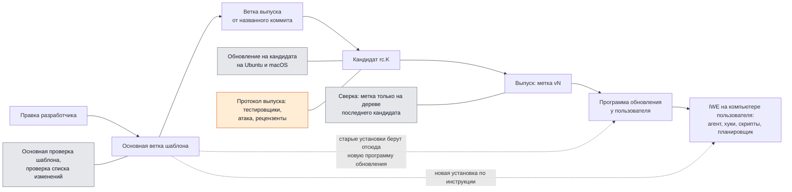

# Шаблон IWE для проверки качества: устройство, пути к пользователю, проверки

Страница для Выпускающего и для того, кто настраивает проверку качества выпуска. На ней собрано, что мы выпускаем, как изменение доходит до пользователя (в том числе в обход проверок), какие проверки уже есть, какие из них останавливают выпуск и что не проверяет никто.

**Откуда это.** Устройство IWE подробно описано в документе [«Архитектура платформы и IWE» (DP.ARCH.001)](https://github.com/MimEcoSys/PACK-digital-platform/blob/main/pack/digital-platform/02-domain-entities/DP.ARCH.001-platform-architecture.md) в паке платформы. Для шаблона там нужны разделы 4.2 (подсистемы IWE), 5.2 (программы), 6.2 (размещение), 11.1 (какая подсистема какой программой исполняется) и 18 (что перестаёт работать при отключении программы). Здесь собрана выжимка под проверку качества, состояние на 19.11.2026. Если страница расходится с паком, прав пак, и страница правится вслед.

## Словарь

| Слово | Что значит |
|---|---|
| шаблон | хранилище [FMT-exocortex-template](https://github.com/TserenTserenov/FMT-exocortex-template): файлы инструкций и программ, из которых у пользователя собирается IWE |
| основная ветка | текущая рабочая версия шаблона; сюда разработчик вливает правки |
| ветка выпуска | копия основной ветки на момент снимка; на ней готовят выпуск |
| кандидат | сборка, которую проверяют перед выпуском; помечается `v<N>-rc.<K>`: `<N>` номер выпуска, `<K>` номер попытки |
| метка | постоянное имя версии в хранилище (`v0.42.0`); по ней пользователи получают выпуск |
| дерево | точное содержимое всех файлов сборки; «то же дерево» значит «ни один файл не отличается» |
| агент | программа ИИ-помощника на компьютере пользователя: Claude Code, Codex, Kimi и другие |
| хук | маленькая программа, которую агент сам запускает на своих событиях: начало сессии, ввод, вызов инструмента, остановка |
| планировщик | служба операционной системы, запускающая программы по расписанию: launchd на macOS, systemd или cron на Linux |
| манифест | список файлов, которые программа обновления кладёт пользователю, с их отпечатками |
| канал обновления | откуда программа обновления берёт версию: выпуск (по умолчанию), кандидаты, основная ветка |

## Схема

Сплошные стрелки показывают путь изменения, пунктир показывает обход проверок кандидата. Цвет показывает, кто проверяет: серым отмечены программы GitHub, оранжевым люди и роли, которые исполняют ИИ-агенты.

Вне компьютера пользователя работают системы окружения: модели у вендора, программы MCP платформы в облаке, хостинг хранилищ и сервисы пользователя. Их сбои не считаются дефектами шаблона.

## Что мы выпускаем

В шаблоне лежат файлы инструкций и программ. Сам по себе шаблон ничего не делает: у пользователя его ставит программа установки (`setup.sh`) и обновляет программа обновления (`update.sh`). Работают уже запущенные программы: агент, его хуки и скрипты, в том числе те, которые планировщик запускает по расписанию. Установщиков под разные системы у шаблона нет: одни и те же скрипты работают на macOS и Linux, а в Windows частично работают через Git Bash. Windows выпуск не обещает.

| Что работает у пользователя | Что делает | Что перестаёт работать, если сломается |
|---|---|---|
| Агент | выполняет работу пользователя, запускает хуки, обращается к знаниям платформы | работа с агентом целиком; задания по расписанию продолжаются |
| Хуки подачи инструкций и памяти | подают агенту инструкции и память, сохраняют снимок перед сжатием длинной беседы, копируют память в резервную копию | агент работает без инструкций и памяти |
| Хуки защиты | не пропускают секреты, личные данные и опасные команды | защита от утечки секретов и разрушительных команд |
| Хуки и скрипты порядка работы | открывают и закрывают сессии, ведут учёт рабочих продуктов и журнал дня, не дают параллельным агентам править одно и то же, публикуют правки | учёт работы; параллельные агенты начинают мешать друг другу; публикация правок |
| Скрипты дня и проверок установки | собирают план дня, сверяют установку с манифестом, проверяют установку, ищут секреты перед сохранением | план дня, регулярные сверки, защита перед сохранением |
| Планировщик с заданиями IWE | запускает фоновые работы и обновление по расписанию | фоновые работы; работа в сессиях идёт |
| Программы установки и обновления | ставят и обновляют IWE | доставка обновлений |
| git и файловая система | хранят все файлы | всё: программам негде читать и писать |

## Как изменение доходит до пользователя

**Через выпуск (основной путь).**
1. Разработчик вливает правку в основную ветку вместе с записью в списке изменений (`CHANGELOG.md`): цель и результат, как проверить, как откатить.
2. Выпускающий называет коммит основной ветки и тип выпуска, и программа нарезает от него ветку выпуска `release/v<N>`.
3. На ветке выпуска ставятся кандидаты. Исправления по находкам идут туда же, и каждый новый кандидат обнуляет все проверки.
4. После слияния ветки выпуска в основную программа выпуска ставит метку `v<N>`. Она сверяет, что дерево совпадает с последним кандидатом и основная проверка шаблона прошла. Проверен ли этот кандидат людьми, программа не знает: это сверяет Выпускающий перед слиянием (см. ниже).
5. У пользователя программа обновления по манифесту обновляет файлы. Без настройки она берёт последний выпуск.

**В обход кандидатов (риски для качества).**
- **Новая установка.** Инструкция в README шаблона ставит IWE копией основной ветки (`gh repo fork … --clone`, затем `setup.sh`). Новый пользователь получает основную ветку, а не проверенный выпуск.
- **Старые установки (0.36 и раньше).** Их программа обновления первым шагом скачивает свою новую версию из основной ветки и перезапускается. Поэтому правка программы обновления в основной ветке действует на старые установки сразу после влития, до выпуска.
- **Файлы, которые кладутся только при установке.** Часть файлов программа обновления дальше не меняет, их правка доходит только до новых установок (категории в [карте критичных путей шаблона](https://github.com/TserenTserenov/FMT-exocortex-template/blob/main/docs/critical-files-map.yaml)).

Механика веток и меток описана в [процессе выпуска шаблона](https://github.com/TserenTserenov/FMT-exocortex-template/blob/main/docs/RELEASE-PROCESS.md).

## Типы выпуска в шаблоне сейчас

Программа нарезки знает два типа: **исправления** (номер `0.42.1`) и **новая функция** (номер `0.43.0`). Набор проверок в протоколе выбирается для каждого выпуска заново, разной обязательной глубины по типам пока нет. Третьего типа (мажорного) нет. Глубину проверки по типам задаёт Выпускающий.

## Какие проверки есть и что останавливает выпуск

**Программы GitHub в шаблоне** ([все файлы проверок](https://github.com/TserenTserenov/FMT-exocortex-template/tree/main/.github/workflows)):

| Проверка | Когда идёт | Что проверяет | Останавливает выпуск? |
|---|---|---|---|
| Основная проверка шаблона (Validate Template) | запрос на слияние в основную ветку и отправка в неё; каждую ночь; при выпуске | скрипты (shellcheck), установку на Ubuntu, тест обновления, возврат на прошлый выпуск и обновление под системным bash macOS, совместимость платформ; на Windows: упрощённый режим разграничения правок в Git Bash, защиту удаления и ещё несколько заданий. Задания на macOS идут на запросах на слияние, ночью и при выпуске, на обычной отправке пропускаются | да: без неё программа выпуска метку не ставит |
| Обновление на кандидата (Release Candidate) | вручную, при постановке каждого кандидата | обновление с последнего выпуска и с 0.36.3 на настоящих машинах Ubuntu и macOS; кандидат ставится, только если записи списка изменений заполнены | да: без неё кандидата нет |
| Проверка списка изменений (Changelog Gate) | запрос на слияние | у правки есть запись в списке изменений | да: обязательна для слияния в основную ветку |
| Проверка источника у автора (Author Source Gate) | запрос на слияние | правка файла, у которого есть источник в установке автора, называет этот источник | нет, пока только предупреждает |
| Ночная проверка шаблона | каждую ночь | лёгкая проверка шаблона и поиск секретов | нет, сигнал |
| Программа выпуска (release.yml) | слияние ветки выпуска | дерево совпадает с последним кандидатом | да: иначе метки нет |
| Сторож зависшего выпуска (Release Watchdog) | каждый день | заводит обращение, если запрос на слияние ветки выпуска завис; уведомление получает владелец хранилища | нет |
| Проверка после выпуска (Post-Release Adversarial Audit) | после выпуска `x.y.0` или вручную | заводит задачу на проверку вышедшей версии | нет |
| Подпись вердикта атаки (attestation) | вручную, на запрос слияния ветки выпуска | подписывает вердикт независимой атаки | нет |
| Анонс обновления (notify-update) | каждый день | собирает анонс, проверяет его текст и рассылает подписчикам | нет; это работа редактора материалов |
| Срочное оповещение о безопасности (notify-security) | каждая отправка в основную ветку | рассылает подписчикам новые строки о безопасности из списка изменений сразу, до выпуска | нет |

**В этом хранилище.** Перед слиянием ветки выпуска Выпускающий запускает программу сверки решений (`python3 tools/check_decisions.py --require-final --rc-tree <дерево>`). Она находит незаполненную форму решений и отметки, сделанные не на той сборке. Проверка запросов на слияние здесь ищет личные данные.

**Люди и роли, которые исполняют ИИ-агенты.** На каждом выпуске работают по протоколу папки выпуска (в 0.42 — [18 строк](../releases/0.N/0.42/protocol.md)). Колонка «Блокирует» в протоколе содержит предложение Разработчика; окончательно, какие строки обязательны, решает Выпускающий в форме решений выпуска. Проверки в протоколе:
- чистая установка и обновление со старых версий на macOS, Linux, Windows;
- возврат на прошлый выпуск;
- открытие и закрытие дня на кандидате;
- установка фоновых ролей на Linux;
- проверка навыков агента, изменённых в выпуске;
- проверка анонса для пользователей;
- независимая атака на одноразовой копии установки: установка, обновление, откат, права агента, защитные проверки;
- проверка входа в разных клиентах (Claude Code, Claude Desktop, ChatGPT) и лёгкого первого знакомства с IWE.

Роли Рецензента выпуска, Аудитора кода и Рецензента доказательств исполняют ИИ-агенты с правом только читать ([роли](pipeline.md#роли)).

**Что считается блокирующей ошибкой сейчас:**
- не пройдена строка протокола, которую Выпускающий в форме решений назвал обязательной, и он не принял оговорку;
- вердикт атаки «заблокировано» (BLOCKED) или «не удалось проверить» (`cannot_verify`) на дереве кандидата;
- отметки сделаны не на дереве выпускаемого кандидата.

Любое исправление даёт нового кандидата, и все строки проверяются заново.

## Что меняется и что это проверяет

Таблица помогает построить план проверок по влиянию изменения. Номера строк даны по протоколу 0.42.

| Что меняет правка | Строки протокола 0.42 | Что проверяют программы | Кто проверяет вживую |
|---|---|---|---|
| Установка и обновление | 1, 2, 3, 4, 6 | обновление на кандидата с последнего выпуска и с 0.36.3 на Ubuntu и macOS; тест обновления и возврата | тестировщики macOS и Windows |
| Планировщик и фоновые роли | 5, 9 | установка ролей и обновление расписания на Linux (на заглушках); задания планировщика macOS при обновлении на кандидата | тестировщик Linux; на macOS вживую никто |
| Хуки защиты | 13 | проверка скриптов, ночной поиск секретов, защита удаления на Windows | проверяющий независимой атаки |
| Порядок работы и учёт сессий | 5 | разграничение правок на Windows в Git Bash | тестировщик (открытие и закрытие дня) |
| Навыки и инструкции агента | 10, 12, 17, 18 | — | Разработчик, тестировщики |
| Доступ к знаниям платформы | 8, 14, 16 | — | тестировщики |
| Анонс | 11 | проверка текста анонса при сборке | Разработчик |

**Откуда брать список изменений выпуска:** раздел версии в списке изменений шаблона (у каждой записи есть цель и результат, как проверить, как откатить), список кандидатов в папке выпуска (`candidates.md`) и [карта критичных путей](https://github.com/TserenTserenov/FMT-exocortex-template/blob/main/docs/critical-files-map.yaml), где по пути файла видно, к какой категории доставки он относится.

## Чего вживую не проверяет никто

- **macOS.** Программы GitHub обновляют каждого кандидата на настоящей машине macOS, но живого тестировщика macOS нет. В 0.42 шесть строк вышли оговорками ([итог 0.42](../releases/0.N/0.42/retro.md)).
- **Задания по расписанию на macOS после установки и обновления.** Полной проверки ещё нет.
- **Windows.** Программы проверяют часть заданий, а тестировщика нет. Выпуск Windows не обещает.
- **Linux с фоновыми ролями.** Программы проверяют логику на заглушках, вживую проверяет только человек.
- **Прогон протокола без человека.** Стенд описан как проект ([run-stand.md](run-stand.md)), программы пока нет.
- **Пути в обход кандидатов.** Новая установка с основной ветки и самообновление старых установок выше не проверяются протоколом выпуска.
- **Что происходит у пользователей после выхода.** Данных о том, кто на какой версии и почему не обновился, нет.

## Вопросы для настройки проверки качества

Решает Выпускающий; здесь только перечень.

1. Какие строки протокола обязательны для выпуска исправлений и какие для выпуска с новой функцией.
2. Что делать с путями в обход кандидатов: ставить новых пользователей с последнего выпуска и закрепить, откуда старые установки берут программу обновления.
3. Какие строки перевести с человека на программы или стенд.
4. Кто проверяет macOS и Linux вживую и что делать, если проверяющего нет: выпуск ждёт или выходит с оговоркой.
5. Как узнавать, что происходит у пользователей после выхода, без сбора личных данных.
